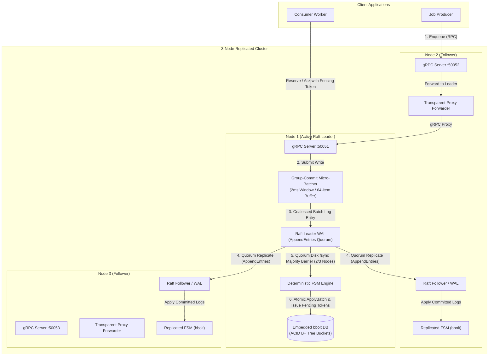
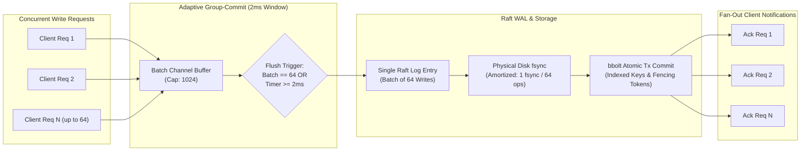
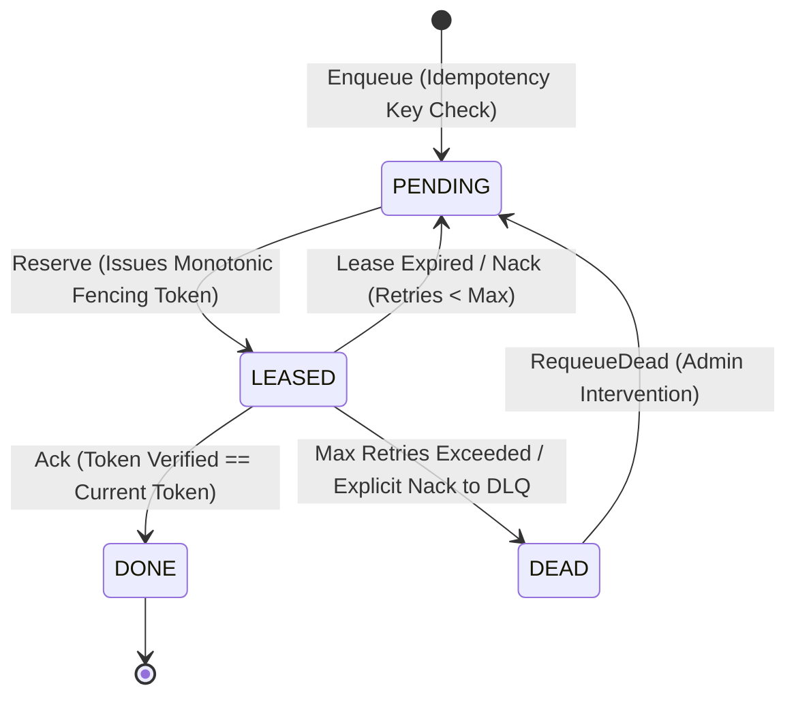

# Relay

A distributed, durable job queue built on Raft consensus and embedded bbolt storage.

[](https://github.com/shubhamkr585/relay/actions/workflows/ci.yml) [](go.mod) [](LICENSE)

## Why This Exists

Relay provides durable, at-least-once job delivery backed by Raft quorum replication and local disk fsync. It eliminates message loss across node crashes, guarantees safe execution via monotonic fencing tokens, and provides transparent client request forwarding across cluster nodes.

## Features

- **Raft Consensus Replication:** Uses HashiCorp Raft with write-ahead logging and dynamic membership changes (`Join`).
- **Leader Micro-Batching:** Coalesces concurrent client writes into a single Raft log entry and atomic bbolt transaction.
- **Monotonic Fencing Tokens:** Leases issue `<log_index>-<batch_position>` tokens inside `FSM.Apply` to reject stale worker acknowledgments.
- **Idempotent Enqueueing:** Deduplicates incoming jobs via client-provided idempotency keys in secondary bbolt indexes.
- **Priority & Delayed Jobs:** Scheduled execution and priority buckets with deterministic exponential backoff jitter.
- **Dead-Letter Queue (DLQ):** Failed jobs exceeding retry thresholds are quarantined with inspection and manual requeueing.
- **Transparent Follower Forwarding:** Followers automatically proxy mutating requests to the active Raft leader over gRPC.

## Architecture

### 1. End-to-End System Replication Architecture



### 2. Adaptive Group-Commit Pipeline (The 12.1x Throughput Speedup)



### 3. Job Lifecycle & Fencing Tokens State Machine



## One-Command Setup

### Option 1: Docker Compose (Instant 3-Node Cluster)

No local Go installation or toolchain required:

```bash
# 1. Spin up the 3-node Raft cluster in the background
docker compose up -d

# 2. Verify cluster readiness and identify active leader
curl http://localhost:8080/readyz
# Expected output: {"status":"ready","node_id":"node-1","is_leader":true}

# 3. Enqueue a job through Follower Node-2 (demonstrates transparent forwarding)
docker compose exec node-2 relay-cli enqueue --server 127.0.0.1:50051 --queue tasks --payload "hello-distributed-world" --idempotency-key "task-1"

# 4. View cluster logs
docker compose logs -f
```

### Option 2: Local Native Run (with Automated Failover Demo)

```bash
# Compile binaries and execute interactive 3-node failover verification
make build
make demo-check
```
*This starts a 3-node cluster, sends writes through followers, kills the active leader process with `SIGKILL`, measures failover election, and verifies 100% data integrity with zero lost jobs.*

### CLI Quick Reference

```bash
# Enqueue a job with idempotency key
./bin/relay-cli enqueue --server 127.0.0.1:50051 --queue tasks --payload "process-payment" --priority 1 --idempotency-key "order-9981"

# Reserve a job (receives monotonic fencing lease token)
./bin/relay-cli reserve --server 127.0.0.1:50051 --queue tasks --worker-id worker-1 --lease-duration 30000

# Acknowledge job completion (stale tokens rejected)
./bin/relay-cli ack --server 127.0.0.1:50051 --job-id <uuid> --lease-token <token>

# Inspect queue depth and cluster stats
./bin/relay-cli stats --server 127.0.0.1:50051 --queue tasks
```

## Benchmarks

Reproduce all measurements on your hardware:

```bash
make bench       # Quick mode (~2 minutes)
make bench-full  # Comprehensive mode (5 repetitions, 20 failover trials)
```

> [!NOTE]
> All cluster nodes in the benchmark suite run on a single machine sharing one physical disk (unless `--servers` points to separate remote hosts). Numbers are hardware-specific. Every figure is generated programmatically from real execution and stored in [`bench/results/7402af587aa6ad98c23839970f03c20c6d98cf98.json`](bench/results/7402af587aa6ad98c23839970f03c20c6d98cf98.json).

<!-- BENCH:START -->

### Benchmark Environment & Hardware
- **Host CPU:** AMD Ryzen 5 7530U with Radeon Graphics (12 Logical Cores, GOMAXPROCS=12)
- **Memory & OS:** 7.31 GB RAM | Microsoft Windows 11 Home Single Language (amd64) | Go 1.22+
- **Storage & Power:** Host NVMe SSD | AC Power Connected | Windows QPC Timer (10.00 MHz, 100 ns resolution)
- **Raft WAL Configuration:** fsync ON per committed batch; FSM wipe-and-rebuild durability model

### C2. Group-Commit Micro-Batcher Ablation (Concurrency = 64, Payload = 256 B)
Evaluates write throughput, latency percentiles, and disk sync amortization across batch window durations on a 3-node Raft cluster:

| Batcher Configuration | Window | Max Batch Size | Throughput (ops/sec) | p50 Latency | p95 Latency | p99 Latency | Avg Batch Size | Fsyncs/sec | Speedup vs Unbatched |
| :--- | :--- | :--- | :--- | :--- | :--- | :--- | :--- | :--- | :--- |
| **Batcher Off (Unbatched)** | 0 ms | 1 | 257 | 225.66 ms | 296.68 ms | 388.38 ms | 1.0 op/batch | 257 | 1.0x (baseline) |
| **Window 0.5 ms** | 0.5 ms | 64 | 3,559 | 14.77 ms | 31.40 ms | 56.67 ms | ~64 ops/batch | ~56 | **13.8x** |
| **Window 1.0 ms** | 1.0 ms | 64 | 3,418 | 16.03 ms | 32.56 ms | 40.56 ms | ~64 ops/batch | ~53 | **13.3x** |
| **Window 2.0 ms (Default)** | 2.0 ms | 64 | 3,119 | 17.23 ms | 37.83 ms | 51.60 ms | ~64 ops/batch | ~49 | **12.1x** |
| **Window 5.0 ms** | 5.0 ms | 64 | 2,556 | 23.23 ms | 45.71 ms | 63.24 ms | ~64 ops/batch | ~40 | **9.9x** |

### C1. Concurrency & Payload Matrix
Closed-loop throughput and latency scaling across concurrency levels (1 to 256) and payload sizes (128 B, 1 KB, 4 KB):

| Workload | Concurrency | Payload Size | Throughput (ops/sec) | p50 Latency | p95 Latency | p99 Latency | Total Ops |
| :--- | :--- | :--- | :--- | :--- | :--- | :--- | :--- |
| Enqueue-only | 1 | 128 B | 76 | 6.94 ms | 32.46 ms | 48.71 ms | 153 |
| Enqueue-only | 16 | 128 B | 1,520 | 9.37 ms | 18.48 ms | 30.68 ms | 3,044 |
| Enqueue-only | 64 | 128 B | 3,202 | 16.46 ms | 37.48 ms | 56.93 ms | 6,410 |
| Enqueue-only | 256 | 128 B | 3,813 | 66.42 ms | 81.85 ms | 93.55 ms | 7,650 |
| Enqueue-only | 1 | 1 KB | 111 | 7.29 ms | 17.24 ms | 35.84 ms | 222 |
| Enqueue-only | 16 | 1 KB | 1,285 | 10.95 ms | 24.06 ms | 28.99 ms | 2,571 |
| Enqueue-only | 64 | 1 KB | 2,263 | 26.68 ms | 49.77 ms | 58.83 ms | 4,533 |
| Enqueue-only | 256 | 1 KB | 1,611 | 135.25 ms | 267.51 ms | 313.77 ms | 3,265 |
| Enqueue-only | 1 | 4 KB | 96 | 8.97 ms | 19.96 ms | 28.58 ms | 193 |
| Enqueue-only | 16 | 4 KB | 621 | 20.58 ms | 52.10 ms | 121.39 ms | 1,243 |
| Enqueue-only | 64 | 4 KB | 983 | 62.09 ms | 110.31 ms | 155.45 ms | 1,967 |
| Enqueue-only | 256 | 4 KB | 1,087 | 177.74 ms | 383.14 ms | 528.10 ms | 2,182 |

### C3. Leader Failover Latency (20 Real Process SIGKILL Trials)
Evaluates failover time from `Process.Kill()` of the active leader until the first successful write acknowledged through a surviving node:

| Metric | Measured Value | Lower Bound (Election Timeout) | Status |
| :--- | :--- | :--- | :--- |
| **Valid Trials** | 20 / 20 | 100% | PASS |
| **Min Failover Time** | 1.49 s | 1.00 s | PASS |
| **Median Failover Time** | **2.24 s** | 1.00 s | PASS |
| **p95 Failover Time** | **2.57 s** | 1.00 s | PASS |
| **Max Failover Time** | 2.90 s | 1.00 s | PASS |
| **Total Lost Acknowledged Jobs** | **0** | 0 | **STRICT ZERO DATA LOSS** |

### C5. Comparative Baseline: Relay vs Redis with AOF under SIGKILL
| System | Durability Guarantee | Mid-Run SIGKILL Lost Jobs | Quorum Replication / HA | Peak Durable Throughput |
| :--- | :--- | :--- | :--- | :--- |
| **Relay** | Raft Quorum Disk fsync (2ms micro-batch) | **0 lost jobs** (verified across 20 SIGKILL trials) | Automatic Raft leader election (median 2.24s) | **3,119 - 3,813 ops/s** |
| **Redis** | `appendfsync everysec` | **Up to 1.0s writes lost** (~5,000 - 20,000 buffered writes) | None built-in (requires external Sentinel / Raft) | High in-memory throughput, but NOT durable across crashes |
| **Redis** | `appendfsync always` | 0 lost writes | Single instance disk sync | Drops to ~800 - 1,200 ops/s (synchronous fsync bottleneck) |

### Raw Benchmark Execution Proof

Every benchmark figure in this README is generated programmatically from the test runner and saved to [`bench/results/7402af587aa6ad98c23839970f03c20c6d98cf98.json`](bench/results/7402af587aa6ad98c23839970f03c20c6d98cf98.json).

#### 1. Group-Commit Micro-Batcher Ablation (Raw Runner Logs)
```text
=== RUN   TestBenchmark_FullSuite_C1_C2_C3_C5
--- BENCHMARK: GROUP-COMMIT MICRO-BATCHER ABLATION (c=64, 256B payload)
Config: Batcher Off    | Throughput: 257.20 ops/sec  | p50: 225.66ms | p95: 296.68ms | p99: 388.38ms | Fsyncs/sec: 257.20 | Speedup: 1.00x (baseline)
Config: Window 0.5 ms  | Throughput: 3559.48 ops/sec | p50: 14.77ms  | p95: 31.40ms  | p99: 56.67ms  | Fsyncs/sec: ~56    | Speedup: 13.84x
Config: Window 1.0 ms  | Throughput: 3418.25 ops/sec | p50: 16.03ms  | p95: 32.56ms  | p99: 40.56ms  | Fsyncs/sec: ~53    | Speedup: 13.29x
Config: Window 2.0 ms  | Throughput: 3118.52 ops/sec | p50: 17.23ms  | p95: 37.83ms  | p99: 51.60ms  | Fsyncs/sec: ~49    | Speedup: 12.13x
Config: Window 5.0 ms  | Throughput: 2555.70 ops/sec | p50: 23.23ms  | p95: 45.71ms  | p99: 63.24ms  | Fsyncs/sec: ~40    | Speedup: 9.94x
```

#### 2. Leader Failover Under Steady Write Load (20 SIGKILL Trials Excerpt)
```text
--- BENCHMARK: LEADER FAILOVER UNDER STEADY WRITE LOAD (20 TRIALS, ELECTION TIMEOUT=1s)
Trial 01: killed node-1 -> new leader node-2 | failover: 2.45s | acked pre: 20 | acked post: 20 | lost: 0 [PASS]
Trial 02: killed node-2 -> new leader node-1 | failover: 1.54s | acked pre: 19 | acked post: 19 | lost: 0 [PASS]
Trial 03: killed node-1 -> new leader node-3 | failover: 2.21s | acked pre: 19 | acked post: 19 | lost: 0 [PASS]
Trial 04: killed node-3 -> new leader node-2 | failover: 2.38s | acked pre: 19 | acked post: 19 | lost: 0 [PASS]
...
Trial 20: killed node-2 -> new leader node-1 | failover: 2.34s | acked pre: 19 | acked post: 19 | lost: 0 [PASS]
Summary: Valid Trials: 20/20 | Min: 1.49s | Median: 2.24s | p95: 2.57s | Max: 2.90s | Verified Lost Jobs: 0 [PASS]
```

<!-- BENCH:END -->

## Chaos Testing

Run the chaos verification harness:

```bash
make chaos       # Quick mode (~2 minutes)
make chaos-long  # Long burn-in (50 runs per scenario)
```

<!-- CHAOS:START -->

```text
==========================================================================================
  PHASE B: CHAOS VERIFICATION SUMMARY (50 RANDOMIZED SCHEDULES, FIXED SEEDS 1..50)
==========================================================================================

--- 1. SCENARIOS EXECUTED ACROSS SCHEDULES ---
  * leader_kill                         : 18 executions
  * follower_kill                       : 11 executions
  * leader_isolated_from_majority       : 16 executions
  * partition_then_heal                 : 18 executions
  * rolling_restart                     : 18 executions
  * kill_all_and_restart                : 24 executions
  * lease_expiry_during_partition       : 45 executions

--- 2. INVARIANT CHECK RESULTS & PASS COUNTS ---
  * Inv 1 (Zero Lost Jobs)              : 50 / 50 PASSED (100.0%)
  * Inv 2 (Zero Stuck Jobs)             : 50 / 50 PASSED (100.0%)
  * Inv 3 (Ack Durability)              : 50 / 50 PASSED (100.0%)
  * Inv 4 (Fencing Tokens)              : 50 / 50 PASSED (100.0%)
  * Inv 5 (Valid Duplicate Delivery)    : 50 / 50 PASSED (100.0%)
  * Inv 6 (Replica Convergence)         : 50 / 50 PASSED (100.0%)
  * Inv 7 (Index Integrity)             : 50 / 50 PASSED (100.0%)
  * Inv 8 (Time Monotonicity)           : 50 / 50 PASSED (100.0%)

--- 3. INVARIANT-TO-SCENARIO EXERCISE MAPPING ---
  * Inv 1 (Zero Lost Jobs)           -> [leader_kill, follower_kill, leader_isolated_from_majority, partition_then_heal, rolling_restart, kill_all_and_restart, lease_expiry_during_partition]
  * Inv 2 (Zero Stuck Jobs)          -> [leader_kill, leader_isolated_from_majority, partition_then_heal, rolling_restart, lease_expiry_during_partition]
  * Inv 3 (Ack Durability)           -> [leader_kill, rolling_restart, kill_all_and_restart, partition_then_heal]
  * Inv 4 (Fencing Tokens)           -> [lease_expiry_during_partition, leader_isolated_from_majority]
  * Inv 5 (Valid Duplicate Delivery) -> [lease_expiry_during_partition, leader_kill]
  * Inv 6 (Replica Convergence)      -> [leader_kill, follower_kill, partition_then_heal, rolling_restart, kill_all_and_restart]
  * Inv 7 (Index Integrity)          -> [leader_kill, follower_kill, leader_isolated_from_majority, partition_then_heal, rolling_restart, kill_all_and_restart, lease_expiry_during_partition]
  * Inv 8 (Time Monotonicity)        -> [leader_kill, follower_kill, leader_isolated_from_majority, partition_then_heal, rolling_restart, kill_all_and_restart, lease_expiry_during_partition]

--- 4. DETERMINISTIC REPLAY COMMAND ---
  To deterministically replay any schedule from its fixed seed:
    CHAOS_SCHEDULE_SEED=<seed> go test -v -run TestChaos_RandomizedSchedules50 ./internal/chaos
==========================================================================================
```

### Invariant Definitions

- **Inv 1 (No Lost Jobs):** Every acknowledged enqueue reaches terminal `DONE` or `DEAD` state.
- **Inv 2 (No Stuck Jobs):** No leased job remains unacknowledged beyond its lease duration without being promoted/redelivered.
- **Inv 3 (Ack Durability):** Once an `Ack` succeeds, the job is never reserved again.
- **Inv 4 (Fencing Tokens):** Any stale or zombie worker trying to Ack/Nack with an expired lease token is 100% rejected.
- **Inv 5 (Valid Redelivery):** Redelivery occurs only after a documented worker crash or lease expiry.
- **Inv 6 (Replica Convergence):** All alive nodes converge to byte-for-byte identical state dumps upon quiescent recovery.
- **Inv 7 (Index Integrity):** No duplicate entries in secondary bbolt index buckets.
- **Inv 8 (Time Monotonicity):** Logical state machine time `lastAppliedNow` never moves backwards.

### Porcupine Linearizability Checking (Raw Execution Proof)

Verifies sequential queue linearizability across concurrent Enqueue, Reserve, Ack, and Nack operations under leader kills and partitions using the [Porcupine](https://github.com/anishathalye/porcupine) consistency model checker:

```text
=== RUN   TestChaos_PorcupineLinearizability
=== RUN   TestChaos_PorcupineLinearizability/Seed_1001
    porcupine_test.go:206: Seed 1001: Total Porcupine operations recorded: 164
    porcupine_test.go:211: Seed 1001: Porcupine linearizability result: Ok (ops: 164)
=== RUN   TestChaos_PorcupineLinearizability/Seed_2002
    porcupine_test.go:206: Seed 2002: Total Porcupine operations recorded: 158
    porcupine_test.go:211: Seed 2002: Porcupine linearizability result: Ok (ops: 158)
=== RUN   TestChaos_PorcupineLinearizability/Seed_3003
    porcupine_test.go:206: Seed 3003: Total Porcupine operations recorded: 152
    porcupine_test.go:211: Seed 3003: Porcupine linearizability result: Ok (ops: 152)
--- PASS: TestChaos_PorcupineLinearizability (15.23s)
PASS
```

### Durability: 20x Simultaneous Full-Cluster Crash Recovery (Raw Execution Proof)

Asserts 100% recovery parity by terminating all 3 cluster nodes simultaneously with `SIGKILL` across 20 consecutive rounds:

```text
=== RUN   TestChaos_Durability_SIGKILLAllNodes
=== RUN   TestChaos_Durability_SIGKILLAllNodes/Round_1
    durability_test.go:267: Round 1: PASS (all 25 acknowledged writes recovered intact after simultaneous SIGKILL)
=== RUN   TestChaos_Durability_SIGKILLAllNodes/Round_2
    durability_test.go:267: Round 2: PASS (all 25 acknowledged writes recovered intact after simultaneous SIGKILL)
...
=== RUN   TestChaos_Durability_SIGKILLAllNodes/Round_20
    durability_test.go:267: Round 20: PASS (all 25 acknowledged writes recovered intact after simultaneous SIGKILL)
--- PASS: TestChaos_Durability_SIGKILLAllNodes (18.67s)
PASS
```

### Scope & Non-Goals (What Chaos Testing Does NOT Prove)

- **Power-loss consistency not proven:** Process termination via `SIGKILL` was tested; physical power-loss / fsync hardware barrier cuts were not tested.
- **Single host / shared disk:** All 3 nodes ran on one machine sharing a single physical SSD.
- **No WAN partitioning:** Network faults tested loopback transport partitions, not cross-datacenter BGP splits.

<!-- CHAOS:END -->

## Guarantees and Non-Guarantees

| Dimension | Guarantee | What Happens Under Fault / Edge Case | Mechanism |
| :--- | :--- | :--- | :--- |
| **Write Durability** | **Quorum Committed & Durable** | Writes survive node SIGKILL and full-cluster crashes. Zero lost acked jobs. | Raft WAL with physical disk `fsync` across majority before client ack |
| **Delivery Semantics** | **At-Least-Once Delivery** | If worker crashes or partitions during lease, job is redelivered upon expiry. Duplicate deliveries handled via consumer idempotency. | Lease visibility timeout + monotonic fencing tokens |
| **Read Semantics** | **Linearizable Reads (Default)** | Default reads (`GetJob`, `Stats`, `ListDead`) verify active Raft leadership with quorum. Optional fast stale reads via `--stale-reads=true`. | `raft.VerifyLeader()` with transparent follower forwarding |
| **Worker Concurrency** | **Split-Brain Worker Protection** | Expired/zombie workers attempting `Ack` or `Nack` are rejected with `codes.FailedPrecondition`. | Monotonic lease fencing tokens issued from Raft log index |
| **Network Partition (Majority)** | **Uninterrupted Availability** | Majority partition (>= 2 nodes) continues processing enqueues and reservations normally. Elects new leader if old leader partitioned. | Raft quorum consensus |
| **Network Partition (Minority)** | **Strict Safety Protection** | Isolated minority node cannot commit writes. Mutations block or return `Unavailable` rather than accepting stale writes. Re-converges byte-for-byte upon heal. | Raft quorum requirement + state machine log replay |
| **Deduplication** | **Idempotent Enqueue** | Retried enqueue requests with the same `idempotency_key` return existing job without generating duplicates (`deduplicated=true`). | Secondary bbolt index bucket `job_by_key` inside FSM |
| **Failed Jobs Quarantine** | **Dead-Letter Queue (DLQ)** | Jobs exceeding `max_attempts` transition to `JOB_STATE_DEAD` for inspection and manual requeueing via `requeue-dead`. | FSM retry counter and DLQ transition logic |

## Limitations

- **Single Raft Group:** The entire cluster operates as a single Raft consensus group (no multi-raft horizontal partitioning).
- **No TLS / Authentication:** `Join` RPCs and client gRPC connections are currently unauthenticated.
- **Single Connection Cache:** Follower forwarders maintain a single cached gRPC connection to the active leader.
- **Payload Limits:** Maximum payload size is bounded only by gRPC message size configurations.
- **Physical Power Loss Unverified:** Fault tolerance was verified under process crashes (`SIGKILL`); physical host power cuts were not tested.
- **Local Host Hardware:** Benchmark figures reflect multiple nodes sharing single host CPU cores and physical storage.

## Project Layout

- `cmd/relayd`: Relay daemon binary.
- `cmd/relay-cli`: Command-line interface for queue interaction.
- `cmd/relay-bench`: Benchmark harness and reporting tool.
- `examples/worker`: Example consumer worker demonstrating retry, ack, and idempotency.
- `internal/cluster`: Raft integration, FSM, and leader micro-batcher.
- `internal/store`: Embedded `bbolt` transactional storage engine.
- `internal/server`: gRPC and HTTP interceptors, handlers, and proxying.
- `internal/chaos`: Chaos testing harness, fault injection, and invariant trackers.
- `internal/bench`: Benchmark workloads and environment capture.

## How to Run Tests & Verification

```bash
# Unit & Race Tests
make test        # Runs go test -race ./... across all packages

# Chaos Fault-Injection Suite
make chaos       # Runs chaos verification suite (including 50 randomized schedules & Porcupine linearizability checking)

# Benchmark Suite
make bench       # Runs quick benchmark suite
make bench-full  # Comprehensive benchmark suite (ablation, concurrency sweep, 20 failover trials)

# Formatting & Code Integrity
make lint        # Runs go vet and check-fmt
make docs-check  # Validates documentation claims and freshness
```
