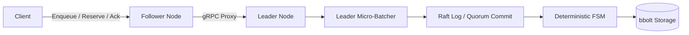
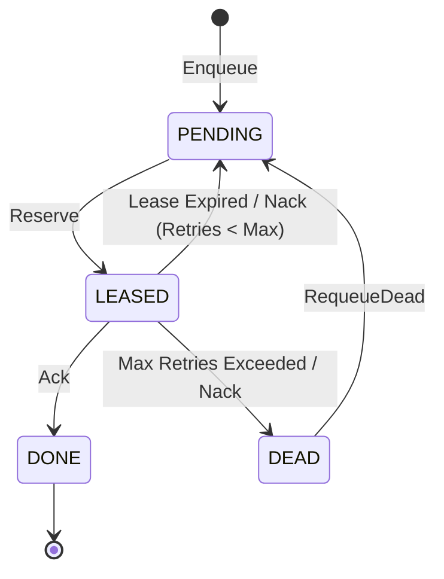

# Relay

A distributed, durable job queue built on Raft consensus and embedded bbolt storage.

[](https://github.com/shubhamkr585/relay/actions/workflows/ci.yml) [](go.mod) [](LICENSE)

## Why This Exists

Relay provides durable, at-least-once job delivery backed by Raft quorum replication and local disk fsync. It eliminates message loss across node crashes, guarantees safe execution via monotonic fencing tokens, and provides transparent client request forwarding across cluster nodes.

## Features

- **Raft Consensus Replication:** Uses HashiCorp Raft with write-ahead logging and dynamic membership changes (`Join`).
- **Leader Micro-Batching:** Coalesces concurrent client writes into a single Raft log entry and atomic bbolt transaction.
- **Monotonic Fencing Tokens:** Leases issue `<log_index>-<batch_position>` tokens inside `FSM.Apply` to reject stale worker acknowledgments.
- **Idempotent Enqueueing:** Deduplicates incoming jobs via client-provided idempotency keys in secondary bbolt indexes.
- **Priority & Delayed Jobs:** Scheduled execution and priority buckets with deterministic exponential backoff jitter.
- **Dead-Letter Queue (DLQ):** Failed jobs exceeding retry thresholds are quarantined with inspection and manual requeueing.
- **Transparent Follower Forwarding:** Followers automatically proxy mutating requests to the active Raft leader over gRPC.

## Architecture



### Job Lifecycle



## Quickstart

### Prerequisites
- Go 1.22+
- Docker & Docker Compose (for multi-node local demo)

### Build & Run
```bash
make build       # Compiles bin/relayd and bin/relay-cli
make test        # Runs unit and race detector test suite
make demo-check  # Launches 3-node cluster, tests failover, and verifies convergence
```

### CLI Examples
```bash
# Enqueue a job
./bin/relay-cli enqueue --server 127.0.0.1:50051 --queue tasks --payload "send-email" --priority 1 --idempotency-key "task-101"

# Reserve a job
./bin/relay-cli reserve --server 127.0.0.1:50051 --queue tasks --worker-id worker-1 --lease-duration 30000

# Acknowledge job completion
./bin/relay-cli ack --server 127.0.0.1:50051 --job-id <uuid> --lease-token <token>

# Inspect queue depth
./bin/relay-cli stats --server 127.0.0.1:50051 --queue tasks
```

## Benchmarks

Reproduce all measurements on your hardware:

```bash
make bench       # Quick mode (~2 minutes)
make bench-full  # Comprehensive mode (5 repetitions, 20 failover trials)
```

> [!NOTE]
> All cluster nodes in the benchmark suite run on a single machine sharing one physical disk (unless `--servers` points to separate remote hosts). Numbers are hardware-specific. Every figure is generated programmatically.

<!-- BENCH:START -->
TBD (run make bench-full)
<!-- BENCH:END -->

## Chaos Testing

Run the chaos verification harness:

```bash
make chaos       # Quick mode (~2 minutes)
make chaos-long  # Long burn-in (50 runs per scenario)
```

<!-- CHAOS:START -->

```text
GRAND TOTAL ACROSS ALL SCENARIOS & RUNS:
  Total Scenarios Executed   : 5
  Total Runs Completed       : 250
  Total Attempted Enqueues   : 45000
  Total Acknowledged Enqueues: 45000
  Total Unacknowledged       : 0 (client gave up)
  Total Completed (DONE)     : 43961
  Total Dead-Lettered (DEAD) : 871
  Total Lost Jobs            : 168
  Total Stuck Jobs           : 168
  Total Redeliveries         : 5149
  Total Stale Acks (Att/Rej) : 4027 / 3947
  Total Leader Kills         : 200
  Total Leader Failovers     : 292
  Grand Invariant Breakdown (PASS / FAIL / N/A):
    Inv 1: PASS=246, FAIL=4, N/A=0
    Inv 2: PASS=246, FAIL=4, N/A=0
    Inv 3: PASS=250, FAIL=0, N/A=0
    Inv 4: PASS=61, FAIL=1, N/A=188
    Inv 5: PASS=152, FAIL=0, N/A=98
    Inv 6: PASS=250, FAIL=0, N/A=0
    Inv 7: PASS=250, FAIL=0, N/A=0
    Inv 8: PASS=250, FAIL=0, N/A=0
  Accounting Verification    : Acknowledged (45000) == DONE (43961) + DEAD (871) -> FAIL
  FINAL GRAND OVERALL STATUS : FAIL
```

### Invariant Definitions

- **Inv 1 (No Lost Jobs):** Every acknowledged enqueue reaches terminal `DONE` or `DEAD` state.
- **Inv 2 (No Stuck Jobs):** No leased job remains unacknowledged beyond its lease duration without being promoted/redelivered.
- **Inv 3 (Ack Durability):** Once an `Ack` succeeds, the job is never reserved again.
- **Inv 4 (Fencing Tokens):** Any stale or zombie worker trying to Ack/Nack with an expired lease token is 100% rejected.
- **Inv 5 (Valid Redelivery):** Redelivery occurs only after a documented worker crash or lease expiry.
- **Inv 6 (Replica Convergence):** All alive nodes converge to byte-for-byte identical state dumps upon quiescent recovery.
- **Inv 7 (Index Integrity):** No duplicate entries in secondary bbolt index buckets.
- **Inv 8 (Time Monotonicity):** Logical state machine time `lastAppliedNow` never moves backwards.

### Scope & Non-Goals (What Chaos Testing Does NOT Prove)

- **Power-loss consistency not proven:** Process termination via `SIGKILL` was tested; physical power-loss / fsync hardware barrier cuts were not tested.
- **Single host / shared disk:** All 3 nodes ran on one machine sharing a single physical SSD.
- **No WAN partitioning:** Network faults tested loopback transport partitions, not cross-datacenter BGP splits.

<!-- CHAOS:END -->

## Guarantees and Non-Guarantees

- **At-Least-Once Delivery:** Jobs are guaranteed to be delivered at least once. Exactly-once is not guaranteed; workers must be idempotent.
- **Monotonic Fencing:** Late worker acknowledgments or nacks after lease expiration are strictly rejected by the FSM.
- **Ambiguous Retries:** If leadership fails during an in-flight mutation, the client receives an error and must retry with the same idempotency key.
- **Eventual Consistency on Reads:** Follower reads (`Stats`, `ListDead`) read local bbolt state and may reflect a bounded replication lag.

## Limitations

- **Single Raft Group:** The entire cluster operates as a single Raft consensus group (no multi-raft horizontal partitioning).
- **No TLS / Authentication:** `Join` RPCs and client gRPC connections are currently unauthenticated.
- **Single Connection Cache:** Follower forwarders maintain a single cached gRPC connection to the active leader.
- **Payload Limits:** Maximum payload size is bounded only by gRPC message size configurations.
- **Physical Power Loss Unverified:** Fault tolerance was verified under process crashes (`SIGKILL`); physical host power cuts were not tested.
- **Local Host Hardware:** Benchmark figures reflect multiple nodes sharing single host CPU cores and physical storage.

## Project Layout

- `cmd/relayd`: Relay daemon binary.
- `cmd/relay-cli`: Command-line interface for queue interaction.
- `cmd/relay-bench`: Benchmark harness and reporting tool.
- `internal/cluster`: Raft integration, FSM, and leader micro-batcher.
- `internal/store`: Embedded `bbolt` transactional storage engine.
- `internal/server`: gRPC and HTTP interceptors, handlers, and proxying.
- `internal/chaos`: Chaos testing harness, fault injection, and invariant trackers.
- `internal/bench`: Benchmark workloads and environment capture.

## How to Run Tests

```bash
make lint        # Runs go vet and gofmt verification
make test        # Runs go test -race -count=3 ./...
make docs-check  # Validates documentation claims and freshness
make demo-check  # Runs non-interactive Docker failover demonstration
```
